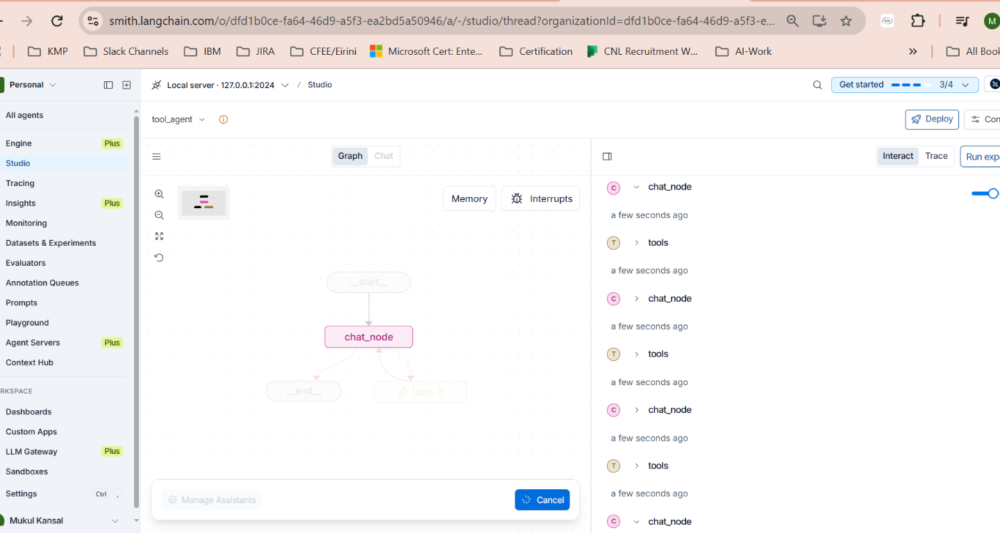
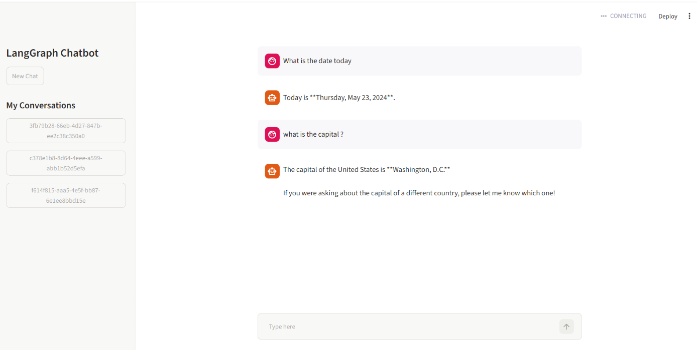

# LangGraph Basics

This repository contains small examples that build on one another to demonstrate LangGraph, chat history, streaming, and checkpoint persistence. The chat examples use [LangChain](https://python.langchain.com/) with a Groq-hosted language model and [Streamlit](https://streamlit.io/) for the interface.

## Requirements

- Python 3.13 or later
- [uv](https://docs.astral.sh/uv/getting-started/installation/)
- A Groq API key to run the chat examples
- A Tavily API key to use real-time web search in the tool-calling app

## Set up

Open PowerShell in the project directory and install the dependencies:

```powershell
uv sync
```

The chat backends read configuration from the environment. Create your local `.env` by copying the example:

```powershell
Copy-Item .env.example .env
```

Edit `.env` and replace the example values with your own keys:

- `GROQ_API_KEY` is required to run the chat examples.
- `TAVILY_API_KEY` is required only when testing web search.
- `OPENAI_API_KEY` is optional; the current examples do not use it.
- LangSmith tracing is disabled by default. To send traces to LangSmith, set `LANGSMITH_TRACING=true` and provide a valid `LANGSMITH_API_KEY`. `LANGSMITH_PROJECT` and `LANGSMITH_ENDPOINT` control the trace project and endpoint.

Keep your keys private. Do not commit `.env` or local chat database files; `.env.example` contains placeholders and is safe to share.

## Examples

### Basic LangGraph

Run the standalone graph:

```powershell
uv run python frontend\main.py
```

It invokes a graph that greets the name supplied in `frontend/main.py`.

### Streamlit chat apps

Run one of the frontends from the project directory:

```powershell
# Basic chat interface
uv run streamlit run frontend\3_streamlit_frontend.py

# Stream assistant responses as they are generated
uv run streamlit run frontend\streamlit_frontend_streaming.py

# In-memory checkpointing with multiple conversation threads
uv run streamlit run frontend\streamlit_frontend_threading.py

# SQLite-backed checkpointing that persists conversations
uv run streamlit run frontend\streamlit_frontend_database.py

# Tool-calling chat with Wikipedia, Tavily, and calculator
uv run streamlit run frontend\streamlit_frontend_tool.py
```

Streamlit opens the selected app in your browser. The database-backed versions store LangGraph checkpoints in `database/chatbot.db`, so conversations can be retrieved after restarting the app. The other chat backends use an in-memory checkpointer, so their checkpointed conversations are lost when the process stops.

#### Tool-calling chat

Run `uv run streamlit run frontend/streamlit_frontend_tool.py` to start the tool-calling app. The assistant can use Wikipedia, Tavily, and the calculator tools. The tool activity panel shows each call's name, arguments, and result; tool errors are shown in the panel as well.

Try prompts such as:

- “Use Wikipedia to give me a short overview of LangGraph.”
- “Use the calculator to multiply 345 by 757575.”
- “Search the web for the latest LangGraph release news.”

The tool backend registers three tools:

- Wikipedia for concise encyclopedia lookup.
- Tavily for real-time web search.
- Calculator for addition, subtraction, multiplication, and division.

Tavily requires `TAVILY_API_KEY`. The Streamlit UI shows tool calls and their results in a status panel, including tool errors.

To check that the sanitizer MCP server is reachable and list its available tools, run the manual connectivity script from the project root:

```powershell
uv run python tests\test_mcp.py
```

#### LangGraph Studio

LangGraph Studio is a visual workspace for testing and debugging an agent. It lets you view the graph, follow node execution, and inspect tool calls and their results. It uses the same tool-calling graph as the Streamlit app, so you can choose Studio for graph-level debugging or Streamlit for the chat UI.

Before starting, install the project dependencies with `uv sync` and make sure `.env` contains `GROQ_API_KEY`. `TAVILY_API_KEY` is only needed to test web search. The local server also needs internet access to load the configured MCP tools.

From the project root, start the development server in PowerShell:

```powershell
$env:LOG_COLOR = "false"
uv run langgraph dev --config langgraph-studio\langgraph.json --no-browser
```

Keep this terminal open while using Studio. Open the Studio URL printed by the server (usually `https://smith.langchain.com/studio/?baseUrl=http://127.0.0.1:2024`) and sign in if prompted. Select the `tool_agent` graph, loaded from `backend/langgraph_studio_backend.py`, start a thread, and submit a prompt such as:

> Use the calculator to multiply 345 by 757575.

You can also try a Wikipedia question or, with `TAVILY_API_KEY` configured, a web-search prompt. The graph and recent node execution appear in Studio; the screenshot below shows an example.



Press **Ctrl+C** in the server terminal when finished.

**Persistence:** Studio uses the local LangGraph server's managed checkpointing. Its threads are separate from the Streamlit tool app's SQLite conversations in `database/chatbot.db`; the two apps do not share chat history.

#### SQLite-backed chat output

1. Run `uv run streamlit run frontend\streamlit_frontend_database.py` from the project directory.
2. Open the local URL printed by Streamlit in your browser (usually `http://localhost:8501`).
3. Enter a message in the chat box and submit it. The user message and the assistant response appear in the conversation.
4. Select **New Chat** to start another thread, or select a conversation in **My Conversations** to load it again.
5. Stop and restart the app. Saved conversations remain available because their LangGraph checkpoints are stored in `database/chatbot.db`.

Example app output:



### How the chat examples work

- `backend/langgraph_backend.py` defines the chat graph and uses an in-memory checkpointer.
- `backend/langgraph_database_backend.py` defines the chat graph with `SqliteSaver` and provides a helper to retrieve saved conversation thread IDs.
- `backend/langgraph_tool_backend.py` defines the SQLite-backed tool graph with Wikipedia, Tavily, and calculator tools.
- `backend/langgraph_studio_backend.py` provides the Studio graph entrypoint without a custom checkpointer.
- `frontend/3_streamlit_frontend.py` provides the basic Streamlit chat UI.
- `frontend/streamlit_frontend_streaming.py` streams assistant output to the UI.
- `frontend/streamlit_frontend_threading.py` lets you create and switch between conversation threads while the app is running.
- `frontend/streamlit_frontend_database.py` uses the SQLite-backed graph to load and continue saved threads.
- `frontend/streamlit_frontend_tool.py` provides SQLite conversation persistence plus visible tool-call activity.

All chat examples use the Groq model configured in the backend. The SQLite database at `database/chatbot.db` is local application data; avoid committing it if it contains conversation content.
